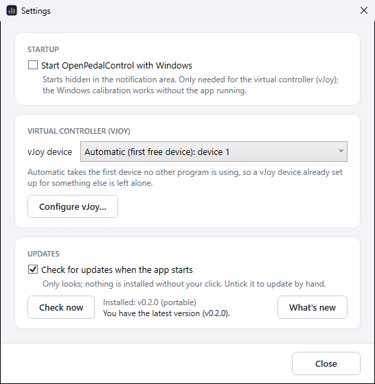

# OpenPedalControl

[](https://github.com/IIPoliII/OpenPedalControl/actions/workflows/build.yml)

A small Windows tool to calibrate and tune **first-generation sim racing pedals and handbrakes** that the
manufacturer's current software no longer supports, such as the original Heusinkveld Sim Pedals ("HE SIM PEDALS"
controller) and the first Heusinkveld handbrake (Leo Bodnar BU0836-LC interface), which until now had to be set
up with DIView.

It gives those devices the workflow newer hardware has: a guided calibration, deadzones, a brake force limit,
output curves and live bars.


## Features

- **Guided calibration.** Release everything, then press each pedal once. The wizard notices which input moved,
  so it does not matter how your pedals are wired, and it remembers the furthest position, so you never have
  to hold a pedal down while reaching for the mouse.
- **Deadzones** at the bottom and top of each pedal.
- **Brake max force.** Reach 100 % braking with a share of the force you calibrated with.
- **Two output modes**, chosen per device (see below):
  - **Windows calibration**: stored in Windows, works with the app closed, curve with one bend.
  - **Virtual controller (vJoy)**: fully custom 6-point curve with presets, the app runs in the tray.
- **Live view** of the raw sensor value and of what a game will receive.
- **Settings**: start with Windows (hidden in the notification area), which vJoy device to use, updates.
- **Updates** from GitHub: checked at startup (can be turned off) or by hand, installed in one click. Each
  download is checked against the SHA-256 GitHub publishes for the release before it runs. After an update the
  app comes back in the tray with a notification; the full changelog is under *What's new*.
- **Raw numbers stay editable**, for those who know their values from DIView.
- Picks up a calibration that already exists in Windows, and can remove its own again without a trace.

## Download

From the [latest release](../../releases/latest):

- **`OpenPedalControl-Setup-x.y.z.exe`** (recommended): installs the app and, if you leave the box ticked,
  the free [vJoy](https://github.com/BrunnerInnovation/vJoy) driver needed for custom curves. Without vJoy you can
  only use the Windows calibration (one-bend curve). vJoy can also be added later from the app's Settings.
- **`OpenPedalControl.exe`** (or the `-portable.zip` with the README and license): the portable app on its
  own, nothing to install.

Windows 10 or 11 (64-bit). The .NET Framework 4.8 it uses is part of Windows. Coming from v0.1.0? It has no
update check yet, so download v0.2.0 once by hand; from then on the app updates itself.

## Settings



- **Start with Windows**: the app starts hidden in the notification area. Only needed in vJoy mode.
- **vJoy device**: *Automatic* takes the first device no other program uses; or pick one of the 16 yourself.
  *Configure vJoy…* opens vJoy's own tool. Without vJoy, this card offers to install it.
- **Updates**: check at startup or by hand, install in one click, and *What's new* for the changelog.

## Output modes

The old controllers have no memory of their own, so whatever you set has to live on the PC. You choose how:

| | Windows calibration | Virtual controller (vJoy) |
| --- | --- | --- |
| Curve | one bend (midpoint) | 6 points, presets or custom |
| App must run while driving | no | yes (sits in the tray) |
| Extra driver | none | vJoy |
| What you bind in your sim | the real pedals | the axes of "vJoy Device" |

**Windows calibration** stores the result through DirectInput (`DIPROP_CALIBRATION`), the same mechanism DIView and
the *Game Controllers* control panel use. Windows applies it for every DirectInput game.

**Virtual controller** reads the raw pedal values, applies deadzones and your curve, and sends the result to
vJoy the moment the pedals report, so it adds no noticeable delay. By default it uses the first vJoy device no
other program is using, so a vJoy device you already set up for something else is left alone; Settings lets you pick
one (vJoy supports up to 16). By default throttle goes to X, brake to Y,
clutch to Z and handbrake to Rx; each can be changed. Closing the window keeps it running in the notification area;
right-click the tray icon to exit. Tip: [HidHide](https://github.com/nefarius/HidHide) can hide the real pedals from
games so they only see vJoy.

## Using it

1. Plug in the pedals and start OpenPedalControl. The device is selected automatically; pick the handbrake from
   the *Device* list.
2. Click **Calibrate…** and follow the steps.
3. Choose the output mode, then adjust deadzones, max force and curve. The *Output* bar shows the effect immediately.
4. Click **Save**.
5. Restart your sim if it was running. In virtual mode, bind the vJoy axes in the sim.

Some sims have their own pedal calibration on top (iRacing, for example). Run it again after changing things here.

## Limitations

- **Nothing is written to the pedals.** Settings live in Windows and in `%APPDATA%\OpenPedalControl\profiles`
  (one JSON file per device). On another PC, calibrate again.
- **Windows mode:** games that read the device raw (bypassing DirectInput) ignore the calibration.
- **No force in kg.** The legacy controller does not report units, so brake force is shown as raw values and percentages.
- Meant for pedals and levers. Self-centering axes (steering wheels, joysticks) should not be calibrated with it.

## Supported devices

| Device | Status |
| --- | --- |
| Heusinkveld Sim Pedals, first generation (`HE SIM PEDALS`, USB `10C4:8B02`) | Tested |
| Heusinkveld Sim Handbrake, first generation (Leo Bodnar BU0836-LC, USB `16C0:05B7`) | Tested |
| Any other HID game controller with analog axes | Shown with one entry per axis |

Reports for other legacy hardware are welcome: open an issue with the device name and USB ID shown under the header.

## Building

Requires the [.NET SDK 10](https://dotnet.microsoft.com/download) on Windows.

```
dotnet build -c Release
dotnet test -c Release
```

The exe ends up in `src/OpenPedalControl/bin/Release/net48/`. The installer additionally needs
[Inno Setup 6](https://jrsoftware.org/isinfo.php):

```
./installer/build-installer.ps1 -Version 0.3.0
```

It downloads the official vJoy installer, checks its SHA-256 and bundles it. Pushing a tag like `v0.3.0` makes
GitHub Actions build everything and publish a release. Add the release to [CHANGELOG.md](CHANGELOG.md) first: it
is built into the app and shown as *What's new*.

## Disclaimer

OpenPedalControl is an independent open source project. It is not affiliated with, endorsed by or supported by
Heusinkveld Engineering, and contains none of their code. Product names are trademarks of their respective owners
and are used only to say which hardware the tool works with. vJoy is © its authors and distributed under the MIT
License; its license is installed next to it.

## License

[MIT](LICENSE)
