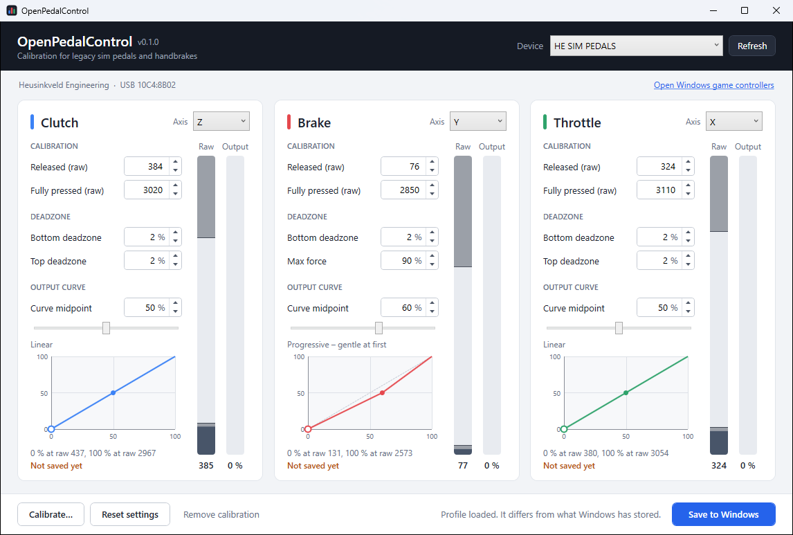

# OpenPedalControl

[](https://github.com/IIPoliII/OpenPedalControl/actions/workflows/build.yml)

A small Windows tool to calibrate and tune **first-generation sim racing pedals and handbrakes** that the
manufacturer's current software no longer supports, such as the original Heusinkveld Sim Pedals ("HE SIM PEDALS"
controller), which until now had to be set up with DIView.

It gives those devices the workflow newer hardware has: a guided calibration, deadzones, a brake force limit,
an output curve and live bars, in one portable 200 KB exe. No installer, no driver, no admin rights.



## Features

- **Guided calibration.** Release everything, then press each pedal once. The wizard notices which input moved,
  so it does not matter how your pedals are wired, and it remembers the furthest position, so you never have
  to hold a pedal down while reaching for the mouse.
- **Deadzones** at the bottom and top of each pedal.
- **Brake max force.** Reach 100 % braking with a share of the force you calibrated with.
- **Output curve.** Make a pedal gentler or more aggressive at the start of its travel.
- **Live view** of the raw sensor value and of what a game will receive.
- **Raw numbers stay editable**, for those who know their values from DIView.
- Picks up a calibration that already exists in Windows, and can remove its own again without a trace.

## Download

Get `OpenPedalControl.exe` from the [latest release](../../releases/latest) and run it. It needs Windows 10 or 11;
the .NET Framework 4.8 it uses is part of Windows.

## Using it

1. Plug in the pedals and start OpenPedalControl. The device is selected automatically.
2. Click **Calibrate…** and follow the steps.
3. Adjust deadzones, max force and curve if you like. The *Output* bar shows the effect immediately.
4. Click **Save to Windows**.
5. Restart your sim if it was running; games read the calibration when they open the device.

Some sims have their own pedal calibration on top (iRacing, for example). Run it again after changing things here.

## How it works

Old controllers like these have no memory of their own: they only send raw 12-bit sensor values. The calibration
therefore has to live on the PC. OpenPedalControl

- reads the raw values directly from the device (HID), unaffected by any calibration, and
- stores the result as the standard Windows game controller calibration through DirectInput
  (`DIPROP_CALIBRATION`), the same mechanism DIView and the *Game Controllers* control panel use.

Windows keeps that calibration per user and applies it for every DirectInput game. The app does not need to keep
running. The settings behind the calibration (deadzones, curve, which axis is which pedal) are kept in
`%APPDATA%\OpenPedalControl\profiles`, one JSON file per device.

## Limitations

- **Nothing is written to the pedals.** Move them to another PC or Windows account and they need calibrating again.
- **Games that bypass DirectInput** (reading the device raw) ignore the Windows calibration. Use the game's own
  calibration there.
- **The curve has one bend.** A Windows calibration is two straight segments meeting at 50 % output, so the curve
  is set with a single midpoint rather than a multi-point editor.
- **No force in kg.** The legacy controller does not report units, so brake force is shown as raw values and percentages.
- Meant for pedals and levers. Self-centering axes (steering wheels, joysticks) should not be calibrated with it.

## Supported devices

| Device | Status |
| --- | --- |
| Heusinkveld Sim Pedals, first generation (`HE SIM PEDALS`, USB `10C4:8B02`) | Tested |
| Heusinkveld Sim Handbrake, first generation | Expected to work, not yet tested |
| Any other HID game controller with analog axes | Shown with one entry per axis |

Reports for other legacy hardware are welcome: open an issue with the device name and USB ID shown under the header.

## Building

Requires the [.NET SDK 10](https://dotnet.microsoft.com/download) on Windows.

```
dotnet build -c Release
dotnet test -c Release
```

The exe ends up in `src/OpenPedalControl/bin/Release/net48/`. Pushing a tag like `v0.2.0` makes GitHub Actions
build it and publish a release.

## Disclaimer

OpenPedalControl is an independent open source project. It is not affiliated with, endorsed by or supported by
Heusinkveld Engineering, and contains none of their code. Product names are trademarks of their respective owners
and are used only to say which hardware the tool works with.

## License

[MIT](LICENSE)
